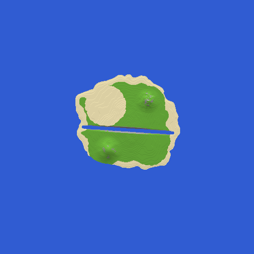
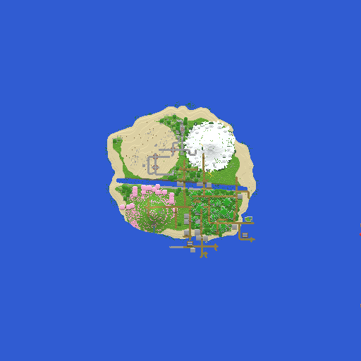

# daRosa - Editor de Mapas (Minecraft)


Editor de mapas de Minecraft **no navegador**, simples o bastante para uma criança: pinte **biomas** e **relevo** vistos de cima,
veja a prévia em 3D, e um gerador transforma o desenho num **mundo jogável** (Minecraft Java 26.3 / Paper).

**▶ Abrir o editor:** <https://darosaweb.github.io/darosa-editor-de-mapas/>

| Antes (o que o gerador grava) | Depois (o Minecraft completou árvores, neve, flores…) |
|---|---|
|  |  |

## O que o editor faz

- **Pincéis de bioma** (21 biomas vanilla, com cores, emojis e legenda) e **balde** para pintar áreas inteiras.
- **Pincéis de terreno**: subir, descer, montanha, rio, alisar e nivelar; tamanho e força ajustáveis.
- **Pincel mágico**: pintar oceano/rio afunda o terreno; pintar terra sobre a água levanta o chão.
- **🏠 Nascer aqui**: marca onde os jogadores aparecem no mundo (sem marca, o gerador escolhe a terra firme mais perto do centro).
- **🏘️ Vila**: marca onde vão ficar as vilas (até 8, longe umas das outras, só em terra). O estilo da vila
  segue o bioma: deserto, savana, taiga, neve ou planície (os demais biomas). Clicar numa vila tira ela.
- **Nível do mar** configurável, água preenchida automaticamente.
- **Prévia 3D** ao vivo (arraste para girar) e mapa 2D por bioma ou por altura.
- **Modo simples** (botões grandes, poucos biomas) e **modo avançado**.
- Desfazer/refazer, **📁 Meus mapas** com salvamento automático e **versões**, backup em arquivo, exportar PNG.
- Tudo em português, sem bibliotecas externas, funciona em computador e tablet (toque).

## Rodar o editor localmente

O editor é só HTML/CSS/JS estático (pasta `editor/`). Com Docker:

```bash
docker compose up -d
```

Abra <http://127.0.0.1:8772>. Os arquivos em `editor/` são servidos direto; editou, recarregou.

## Onde os mapas ficam guardados

- **📁 Meus mapas**: todo mapa fica guardado **no navegador** (IndexedDB), sozinho, alguns segundos depois de cada pincelada.
  O indicador ao lado do nome mostra "✓ guardado". Nada é enviado para servidor nenhum.
- **✨ Novo** cria outro mapa; o anterior continua na lista. Nada é apagado sem pedir.
- **🕘 Versões**: a cada 3 minutos de desenho fica guardada uma "foto" (as 15 mais recentes de cada mapa).
  Voltar para uma versão guarda o estado atual como mais uma versão (dá para desfazer a volta).
- **🗑️ Excluir** só aparece no modo avançado.
- Os dados ficam **naquele navegador, naquele aparelho e naquele endereço**. Limpar os dados de navegação apaga tudo.
  Para ter cópia segura ou levar a outro lugar: **💾 Salvar** (um mapa, `.mcmapa`) ou
  **📁 Meus mapas → Baixar backup de todos** (`.mcbackup`); para trazer de volta: **📁 Meus mapas → Abrir arquivo…**.

## Gerador (Python, roda no PC)

Transforma o `.mcmapa` em arquivos de região Anvil (`.mca`) do Minecraft **26.3** (DataVersion 5023).
Só biblioteca padrão do Python.

Cada chunk é gravado com status **`terrain`** (pedra, água, superfície, biomas e **cavernas** prontos). No 26.x a Mojang
juntou as antigas etapas *noise*, *surface* e *carvers* numa só; então o gerador faz a superfície e as cavernas e o
**Minecraft completa o resto** (árvores, flores, minérios, neve, luz) conforme cada bioma. As **vilas** marcadas no editor
são construídas pelo próprio Minecraft com `/place structure`. Detalhes: [analise/ESTRUTURA.md](analise/ESTRUTURA.md).

- `gerador/criar_mundo.py` — **um comando só: `.mcmapa` → mundo pronto** + imagem + relatório (usa os scripts abaixo)
- `gerador/gerar.py` — projeto `.mcmapa` → regiões `.mca` (terreno, cavernas, anel de oceano em volta do desenho)
- `gerador/testar_local.py` — põe o mapa num Paper de teste local, completa os chunks e desliga
- `gerador/renderizar.py` — imagem vista de cima + contagem de árvores, minérios, neve…
- `gerador/nbt.py`, `gerador/anvil.py`, `gerador/chunkfmt.py` — ler/gravar NBT, regiões e a compactação dos chunks
- `gerador/analisar.py` — análise de chunks reais de um mundo existente
- `gerador/rcon.py` — manda comandos ao servidor de teste
- `gerador/mapa-de-teste.mjs` — cria um mapa 256×256 de teste com o código do próprio editor (Node)

### Testar um mapa num servidor local

O servidor de teste fica em `teste-servidor/` (Paper 26.3 + Java 25 em Docker, `127.0.0.1:25566`).
Os programas do servidor **não vêm no repositório** (a Mojang não permite redistribuir): copie o `paper.jar` e o
`cache/mojang_26.3.jar` do seu próprio servidor para `teste-servidor/dados/`, use `teste-servidor/server.properties.exemplo`
como `teste-servidor/dados/server.properties` e aceite o [EULA](https://aka.ms/MinecraftEULA) em `teste-servidor/dados/eula.txt`.

```bash
python -I -X utf8 gerador/criar_mundo.py mapas/meu-mapa.mcmapa
```

Em uns 2 minutos (mapa 256×256) sai em `saida/meu-mapa/`:

- `mundo-pronto/` — `region/`, `entities/` e `poi/` com os chunks **prontos** (status `full`, vilas com aldeões):
  o servidor de verdade não precisa gerar nada (bom para servidores fracos, como uma Raspberry Pi);
- `mundo.png` e `mundo-desenho.png` — o mundo visto de cima;
- `relatorio.txt` — spawn, borda, vilas, contagem de árvores/minérios/cavernas, arquivos e comandos para instalar.

Opções: `--sem-cavernas`, `--anel N` (chunks de oceano em volta; padrão 8).

## Formato do projeto (`.mcmapa`)

JSON compactado com gzip:

- `largura`, `altura` — tamanho em blocos (x, z)
- `nivelMar` — água preenche toda coluna com altura < `nivelMar`
- `biomas` — lista de nomes (`minecraft:forest`…); `biomaGrade` = 1 byte por coluna, índice nessa lista (base64)
- `alturas` — Int16 little-endian por coluna, linha a linha (z), coluna a coluna (x) (base64): Y do bloco mais alto do terreno
- `alturasFinas` — Float32, só para continuar editando sem perder suavidade
- `marcadores` — `{ nascer: {x, z} | null, vilas: [{x, z}] }` em coordenadas do desenho. O gerador converte para
  coordenadas do mundo e grava em `info.json` o spawn e as vilas (`minecraft:village_<estilo>`).

## Atalhos

Ctrl+Z / Ctrl+Y desfazer/refazer · Ctrl+S salvar · `[` `]` tamanho do pincel · roda do mouse = zoom ·
botão direito, botão do meio ou Espaço + arrastar = mover o mapa · dois dedos = zoom/mover (tela de toque).
